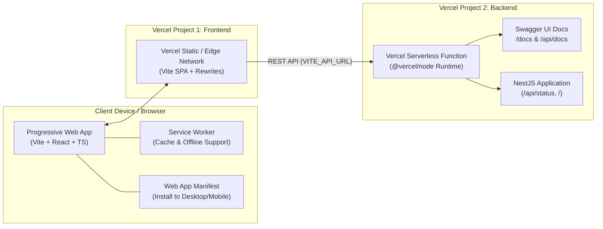

# RUNA LOOP (GEN APHYAH)

Aplikasi pengelolaan Bank Sampah RUNA, Desa Cibunian: pencatatan setoran per KK di empat titik, tabungan nasabah, stok material, pengangkutan, Circular Marketplace, pengolahan organik (kompos dan Maggot BSF), pilot paving block, laporan dampak dan partisipasi, serta timbangan digital ESP32. Acuan kebutuhannya adalah bagian Sasa (RUNA LOOP) di dokumen tim "DSA CIBUNIAN". Frontend **Vite (React 19 + TypeScript + PWA)**, backend **NestJS + Prisma + PostgreSQL**, dokumentasi API **Swagger**, deploy terpisah ke Vercel.

## ♻️ Menjalankan RUNA di lokal

```bash
npm run install:all
cd backend
cp .env.example .env        # lalu isi JWT_SECRET, IOT_DEVICE_KEY, SEED_ADMIN_PASSWORD
npm run db:dev              # Postgres lokal tanpa Docker (prisma dev); lewati bila sudah punya PostgreSQL
npm run db:migrate          # membuat tabel
npm run seed                # akun "admin", 4 titik pengumpulan, 6 kategori
```

Lalu jalankan `npm run dev:backend` dan `npm run dev:frontend` dari root, buka `http://localhost:5173`, dan login sebagai `admin` dengan `SEED_ADMIN_PASSWORD`.

| Bagian | Lokasi |
| :--- | :--- |
| Skema database & migrasi | `backend/prisma/` |
| Modul API per domain | `backend/src/<domain>/` (daftar endpoint: `http://localhost:3000/docs`) |
| Halaman per modul | `frontend/src/features/` |
| Antrean offline (IndexedDB) & klien API | `frontend/src/services/` |
| Firmware timbangan ESP32 + HX711 | `iot/weighing-scale/` |

**Aturan inti:** stok tidak disimpan sebagai angka total, tetapi dihitung dari ledger `inventory_movements`. Pengumpulan dikirim dengan header `Idempotency-Key`, sehingga kirim ulang dari antrean offline tidak membuat transaksi ganda.

**Bisa dipakai tanpa sinyal:** pencatatan pengumpulan, perubahan status pengangkutan, dan catatan batch BSF disimpan di perangkat dulu (IndexedDB), lalu dikirim saat online. Yang ditolak server ditandai untuk ditinjau petugas. Modul lain butuh koneksi.

**Tabungan nasabah (insentif):** setiap kategori bisa diberi *harga beli dari nasabah* di Data Master, terpisah dari harga jual ke pembeli. Setoran yang dicatat atas nama KK menambah tabungannya sebesar berat x harga beli; nilainya dibekukan di transaksi (`collection_transactions.creditAmount`), jadi perubahan harga tidak mengubah setoran lama. Saldo = jumlah setoran dikurangi penarikan (`savings_withdrawals`), dihitung saat dibaca, tidak disimpan sebagai angka total. Penarikan dicatat pengurus atau admin dan ditolak bila melebihi saldo. Setoran dari antrean offline memakai harga saat tersinkron. Laporan menampilkan partisipasi nasabah: berapa KK aktif yang setor pada periode itu, beserta rinciannya per KK.

**Pengolahan organik:** batch bermetode kompos atau Maggot BSF. Bahan bisa diambil dari stok organik (stok berkurang); hasil panen bisa dimasukkan ke stok produk (kategori "Kompos", "Maggot BSF", "Kasgot"). Batch kompos tidak punya catatan residu/kasgot.

**Produk olahan:** kategori berkelompok `PRODUK` (bawaan seed: Maggot BSF dan Kasgot) punya stok seperti material lain. Catatan panen atau residu/frass yang memilih kategori produk menambah stoknya. Pakan BSF bisa berasal dari stok organik RUNA (beratnya dikurangkan dari stok) atau dari mitra seperti restoran dan hotel (tidak lewat stok; nama mitra ditulis di catatan); laporan memisahkan keduanya. Produk yang ditandai "tampil di katalog" bisa diminta dan dijual lewat Marketplace. Prototipe paving block sengaja tidak masuk katalog.

**Laporan:** ringkasan per periode dengan pembanding periode sebelumnya, tren enam bulan (`GET /api/reports/analytics`), cetak/PDF, dan unduh CSV pengumpulan serta penjualan. CSV memakai format Indonesia (pemisah titik koma, desimal koma) dan paling banyak 5000 baris sekali unduh.

**Tes:** `npm run test:e2e:backend` memakai `TEST_DATABASE_URL` (database terpisah yang isinya dihapus tiap run; `npm run db:test` di folder backend). `npm run test:e2e:frontend` memakai Playwright.

**Deploy backend ke Vercel** butuh environment variable tambahan: `DATABASE_URL` (PostgreSQL ter-host), `JWT_SECRET`, `IOT_DEVICE_KEY`, dan `CORS_ORIGIN` (URL frontend). Jalankan `npm run db:migrate` terhadap database produksi sebelum dipakai.

**Supabase sebagai database:** isi `DATABASE_URL` dengan Transaction pooler (port 6543) dan `DIRECT_URL` dengan Session pooler (port 5432); contohnya ada di `backend/.env.example`. Backend memakai login sendiri (JWT), jadi Supabase Auth dan `supabase-js` tidak dipakai. Data API Supabase ditutup lewat migrasi: semua tabel diberi RLS tanpa policy, dan izin peran `anon`, `authenticated`, serta `service_role` dicabut (termasuk untuk tabel yang dibuat nanti).

**Login dan akun:** percobaan login yang gagal dihitung per username dan alamat IP di tabel `login_attempts`, jadi tetap berlaku di Vercel serverless. Lima kali salah dari satu alamat dalam 15 menit mengunci alamat itu untuk username tersebut; 20 kali dari semua alamat mengunci username itu (konstanta di `backend/src/auth/auth.controller.ts`). Setiap pengguna bisa mengganti password sendiri di halaman Akun; itu, dan reset password oleh admin, memutus semua sesi lama akun tersebut. Masa berlaku sesi diatur lewat `JWT_EXPIRES_IN` (bawaan `7d`).

**Urutan saat merilis:** migrasi di repo ini hanya menambah (kolom lama `users.failedLogins` dan `users.lockedUntil` belum dihapus), jadi aman dijalankan sebelum backend baru di-deploy. Backend versi lama tidak mengenal kelompok `PRODUK`, jadi deploy backend terbaru sebelum produk olahan mulai dicatat.

**Tampilan di berbagai perangkat:** tata letak diperiksa dari ponsel 320 px sampai monitor 1920 px, tegak dan rebah. Di bawah 992 px navigasi memakai tab bawah; di atasnya rel samping. Tabel yang tidak muat di wadahnya otomatis ditumpuk menjadi kartu (lihat `useStackWhenNarrow` di `frontend/src/components/Resource.tsx`), jadi tidak ada tabel yang perlu digeser ke samping.

### Keputusan dan catatan tim (16 November 2026)

Sudah diputuskan:

- Acuan sistem RUNA adalah bagian Sasa (RUNA LOOP) di dokumen "DSA CIBUNIAN". Hal yang berkaitan dengan Desa Cinanjung tidak dimasukkan ke sistem ini.
- Insentif nasabah berupa tabungan rupiah per KK dari setoran.
- Sesi login berlaku 7 hari.
- Pakan BSF boleh dari stok organik RUNA atau dari mitra (restoran, hotel).
- Ekspor laporan cukup CSV.
- Batas percobaan login: 5 kali per alamat dan 20 kali per username dalam 15 menit.

Belum dikerjakan, menunggu keputusan atau waktu:

- **Backup database:** paket gratis Supabase tidak punya backup. Rencananya naik paket setelah dana program cair; sampai saat itu, unduh CSV laporan secara berkala sebagai cadangan sederhana.
- **Akun uji per role** dan data pembeli contoh di database: dihapus atau dinonaktifkan setelah uji coba selesai.
- **Kolom lama** `users.failedLogins` dan `users.lockedUntil`: dihapus lewat migrasi tersendiri setelah backend terbaru ter-deploy.

---

## 🏛️ Arsitektur Sistem

Aplikasi ini dirancang dengan pemisahan tanggung jawab (*separation of concerns*) yang jelas antara frontend dan backend, baik saat dijalankan di lingkungan lokal maupun saat di-deploy ke Vercel secara terpisah:



---

## 📁 Struktur Direktori Monorepo Workspace

```text
GEN_APHYAH/
├── backend/                       # Server NestJS (API, Swagger, Services)
│   ├── src/
│   │   ├── common/                # Shared DTOs, Global Exception Filters
│   │   ├── config/                # Centralized Environment Configuration
│   │   ├── app.controller.ts      # REST Endpoints (/ & /api/status) + Swagger
│   │   ├── app.service.ts         # Business Logic
│   │   ├── app.module.ts          # Root Module
│   │   └── main.ts                # Bootstrap (Standalone & Vercel Serverless Handler)
│   ├── test/                      # E2E Tests (Vitest + Supertest)
│   ├── .env.example               # Contoh konfigurasi environment
│   ├── .gitignore                 # Aturan ignore spesifik backend
│   ├── package.json               # Dependensi & skrip backend
│   ├── vercel.json                # Konfigurasi serverless Vercel (@vercel/node)
│   └── README.md                  # Dokumentasi teknis backend
│
├── frontend/                      # Client Vite + React + TS + PWA
│   ├── e2e/                       # E2E Tests (Playwright)
│   ├── public/                    # Assets, favicon & ikon PWA (192x192, 512x512)
│   ├── src/
│   │   ├── components/            # Komponen UI reusable (StatusBadge, dll.)
│   │   ├── hooks/                 # Custom Hooks (useNetworkStatus, dll.)
│   │   ├── services/              # API Client terpusat (api.ts)
│   │   ├── types/                 # TypeScript Types & Interfaces
│   │   ├── utils/                 # Utility functions & helpers
│   │   ├── App.tsx                # Dashboard interaktif & API tester
│   │   ├── ReloadPrompt.tsx       # Auto-update banner Service Worker
│   │   └── vite-env.d.ts          # Client environment types
│   ├── .env.example               # Contoh konfigurasi environment (VITE_API_URL)
│   ├── .gitignore                 # Aturan ignore spesifik frontend
│   ├── playwright.config.ts       # Konfigurasi Playwright
│   ├── package.json               # Dependensi & skrip frontend
│   ├── vercel.json                # Konfigurasi SPA rewrite Vercel
│   ├── vite.config.ts             # Konfigurasi Vite & VitePWA
│   └── README.md                  # Dokumentasi teknis frontend
│
├── .vscode/                       # Pengaturan editor VS Code
│   ├── extensions.json            # Rekomendasi ekstensi
│   └── settings.json              # Pengaturan workspace editor
├── .gitignore                     # Aturan ignore global monorepo
├── gen-aphyah.code-workspace      # VS Code Multi-Root Workspace file
├── package.json                   # Root shortcut scripts
└── README.md                      # Dokumentasi utama proyek (file ini)
```

---

## 📋 Prasyarat Sistem

- **Node.js**: Versi `>= 18.0.0` (Sangat disarankan Node 20 LTS atau Node 22)
- **npm**: Versi `>= 9.0.0`
- **Git**: Versi `>= 2.30.0`

---

## 🚀 Panduan Menjalankan di Lokal (Quick Start)

### 1. Instalasi Seluruh Dependensi
```bash
npm run install:all
```

### 2. Menjalankan Backend (Terminal 1)
```bash
npm run dev:backend
```
- Server API: `http://localhost:3000`
- **Dokumentasi Swagger OpenAPI**: **`http://localhost:3000/docs`**

### 3. Menjalankan Frontend (Terminal 2)
```bash
npm run dev:frontend
```
- Web Application: **`http://localhost:5173`**

---

## ☁️ Panduan Deploy ke Vercel Secara Terpisah

Karena struktur repositori adalah monorepo (`frontend/` dan `backend/`), Anda dapat membuat **2 Proyek Terpisah di Vercel** dari satu repository GitHub yang sama:

### Langkah 1: Deploy Backend Terlebih Dahulu (Proyek 1 di Vercel)
1. Buka [Vercel Dashboard](https://vercel.com/) -> **Add New...** -> **Project**.
2. Pilih repository: **`Couraa0/GEN_APHYAH`**.
3. Di bagian **Root Directory**, klik **Edit** dan pilih folder **`backend`**.
4. Vercel akan otomatis mengenali konfigurasi [`backend/vercel.json`](file:///c:/Users/Rakha/OneDrive/Documents/GEN_APHYAH/backend/vercel.json).
5. Pada bagian **Environment Variables**, tambahkan:
   - `NODE_ENV` = `production`
6. Klik **Deploy**.
7. Salin URL backend yang dihasilkan (contoh: `https://gen-aphyah-backend.vercel.app`).
   - Uji API: `https://gen-aphyah-backend.vercel.app/api/status`
   - Uji Swagger: `https://gen-aphyah-backend.vercel.app/docs`

---

### Langkah 2: Deploy Frontend (Proyek 2 di Vercel)
1. Kembali ke [Vercel Dashboard](https://vercel.com/) -> **Add New...** -> **Project**.
2. Pilih kembali repository yang sama: **`Couraa0/GEN_APHYAH`**.
3. Di bagian **Root Directory**, klik **Edit** dan pilih folder **`frontend`**.
4. Pengaturan Build:
   - **Framework Preset**: `Vite` (otomatis)
   - **Build Command**: `npm run build`
   - **Output Directory**: `dist`
5. Pada bagian **Environment Variables**, tambahkan URL backend dari Langkah 1:
   - `VITE_API_URL` = `https://gen-aphyah-backend.vercel.app` *(gunakan URL backend Anda)*
6. Klik **Deploy**.
7. Frontend PWA Anda kini aktif di URL Vercel (contoh: `https://gen-aphyah-frontend.vercel.app`) dan terhubung langsung ke backend serverless!

---

## 🧪 Menjalankan Pengujian (E2E & Unit Tests)

### Pengujian E2E Backend (NestJS + Vitest):
```bash
npm run test:e2e:backend
```

### Pengujian E2E Frontend (Playwright):
```bash
npm run test:e2e:frontend
```

### Menjalankan Seluruh E2E Test:
```bash
npm run test:e2e
```

---

## 📜 Ringkasan Perintah NPM

| Perintah | Deskripsi |
| :--- | :--- |
| `npm run install:all` | Menginstal semua dependensi di frontend & backend |
| `npm run dev:frontend` | Menjalankan Vite dev server (`localhost:5173`) |
| `npm run dev:backend` | Menjalankan NestJS dev server (`localhost:3000`) |
| `npm run build:frontend` | Build produksi frontend + Service Worker |
| `npm run build:backend` | Kompilasi TypeScript backend |
| `npm run test:e2e:backend` | Menjalankan pengujian E2E backend |
| `npm run test:e2e:frontend` | Menjalankan pengujian E2E frontend |
| `npm run test:e2e` | Menjalankan seluruh pengujian E2E |

---

## 🔗 Dokumentasi Detail Masing-Masing Modul

- ⚡ [Dokumentasi Lengkap Frontend (Vite + PWA + Vercel)](file:///c:/Users/Rakha/OneDrive/Documents/GEN_APHYAH/frontend/README.md)
- 🦁 [Dokumentasi Lengkap Backend (NestJS + Swagger + Vercel)](file:///c:/Users/Rakha/OneDrive/Documents/GEN_APHYAH/backend/README.md)
